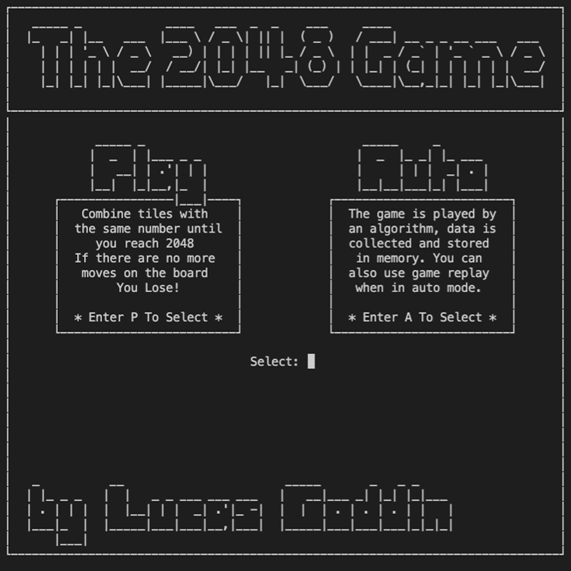
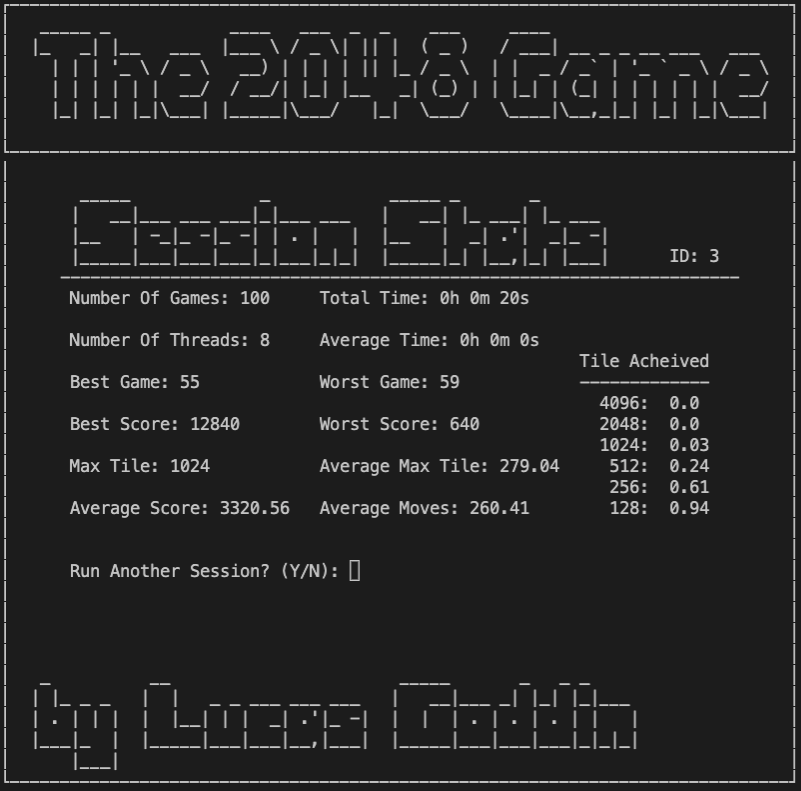
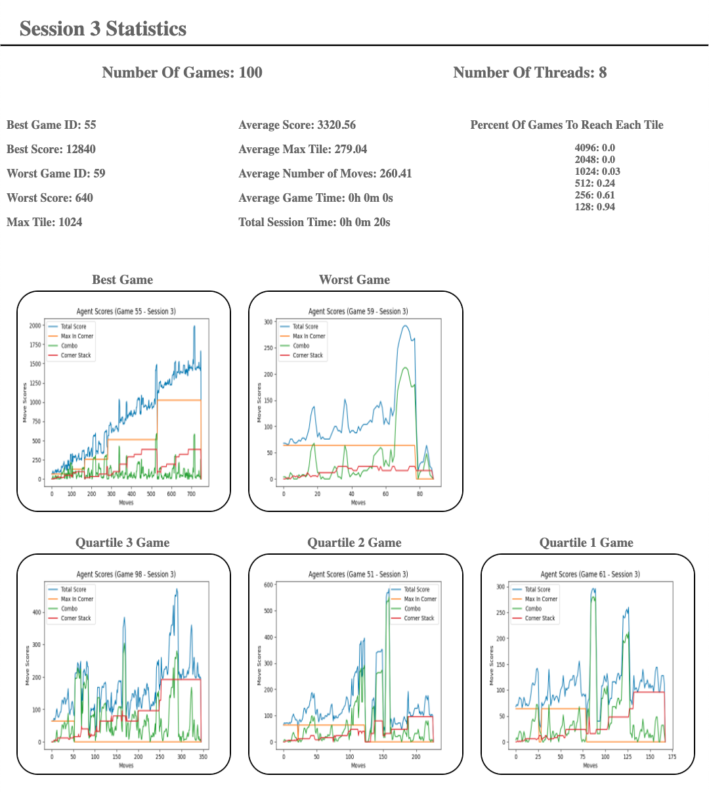

# Terminal 2048
The objective of the game is to create the 2048 tile by combining tiles with the same number.
The tiles are multiples of 2, every turn a new tile is generated.  

## Status  
Under Development  

## Motivation
I created this project to learn more about algorithms. My first goal was to create the game and recording system. Then I used these tools to experiment with different ways of playing using an algorithm or agent.

## What This Demonstrates
The game is the instrument; the experiment and the analysis on top of it are the point.

1. **Score every decision.** Each turn the agent evaluates all four directions on four criteria - whether the largest tile is in a corner, the combinations available after the move, and how tightly the large tiles are stacked - and logs all four scores for the move it chose. See `Agent.my_algorithm`.
2. **Run the experiment in bulk.** A session plays a chosen number of games across up to eight parallel processes, and each game's boards, moves and score components are written to a CSV under `MoveLogs/`.
3. **Analyse the batch with pandas.** `gameSummaries.csv` holds one row per game. The score distribution is read as quartiles and five games are selected out of it - worst, the three quartiles, and best - so the games worth looking at are chosen by the data rather than by eye. See `Graphing.find_quartile_games`.
4. **Graph the reasoning with matplotlib.** Each selected game gets a line chart of its four score components over the course of the game, which shows *why* a game went well or badly rather than only that it did.
5. **Render the report.** Jinja 2 builds a static `stats.html` from the session stats and the charts, and further graphs can be added to an existing report without rerunning the session.
6. **Replay any game.** Any recorded game can be stepped through move by move, with the board and the scores the agent saw at each decision.

The 2048 game, the recording system and the analysis are all first-class parts of the project: the game exists so that there is something worth measuring.

## User Experience
2048 Gameplay
<br>


<hr>
In Game Statistics Screen
<br>


<hr>
Saved HTML Statistics Report
<br>



## Features
* Standard user play mode
* Automated gameplay mode
* Multithreaded automated gameplay
* Generate HTML statistics reports for sessions of automated games
* Replay automated games
* Graphing of algorithm decision making for specific games


## Controls
* Menus
    * Use the options to navigate
    * Only enter one letter at a time then press enter
    * Use q to exit from any feature to the most recent menu.

* Game
    * Use w, a, s, d as arrow keys to move up, left, down and right accordingly
    * Only type one letter per move and press enter to make the move
    * Use q to exit from game to the main menu

## Installation
Use the package manager [pip](https://pip.pypa.io/en/stable/) to install dependencies found in requirements.txt.
Follow the instructions below to set up your virtual enviornment:

1. Create the virtual environment using python3's venv command
    >$python3 -m venv /example/path/destination/.env
    - Make sure to include /venv at the end in order to package the environment in a single directory

2. Navigate to the directory containing /.env
    >$cd /example/path/destination
3. Activate the virtual environment by calling the 'activate' script
    Mac/Linux:

    >$source .env/bin/activate

    Windows:

    >C:\\..\destination> .env\\bin\\activate.bat

4. Install dependencies using the included requirements file
    >$pip install -r requirements.txt  

5. Compile Scss - optional
    The compiled `style.css` and `style.css.map` are committed, so this step is only needed if you change `style.scss`.
    
    I use an extension for VS Code called ***Live Sass Compiler*** (v.3.0) currently. 
    If you have VS Code:
    * Click Extensions On Left Most Menu
    * Search Live Sass Compiler (it has the purple eye)
    * Install the extension and click *Watch Sass* in the bottom right corner
    <br>
    <br>

    If you dont have VS Code You can use gem to install sass, navigate to the 
    /htmlReportData folder and enter:
     >$gem install sass
     
     Then

     >$sass --watch

     This should compile *'style.css.map'* and *'style.css'*

6. Run Terminal 2048
    >$python3 main.py

Next create a config file, config.json. This file only needs to contain a path for recordings to be saved.

Example config.json:

```json
{
    "recording_path": "/Users/bobsmith/Documents/pythonProjects/2048Recording"
}
```

## Dependencies Used
Terminal 2048 is built with
* Pandas
* Matplotlib
* Jinja 2

## Credits
Original 2048 game devloped by Gabriele Cirulli
* [Official Website](https://play2048.co/)
* [2048 Source Code On Github](https://github.com/gabrielecirulli/2048)

## Author
Lucas Goddin

